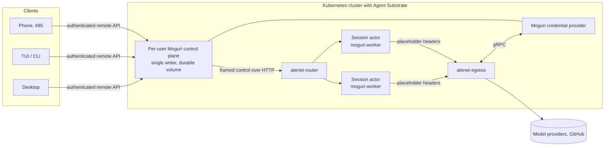

# Cloud fleet on Agent Substrate (analysis)

**Status: analysis only, 2026-11-19.** This is not a decision, not implemented
and not on the ordered roadmap. It covers how Moguri could later run many
sessions as cloud agents on
[Agent Substrate](https://github.com/agent-substrate/substrate) once
[native SendBox](managed-sandbox.md) is production ready. Any adoption needs a
new decision in [decisions](decisions.md), a Phase 0 spike and the change
contract below. Nothing here relaxes D07, D10, D13, D20, D25 or D26.

"Fleet" here means many concurrent Moguri sessions per user (or team) running
off the user's machine, started by people, schedules or GitHub/Slack events,
progressing while the laptop is closed and steered from desktop, TUI or phone.
That is the [deferred](../implementation.md#sessions-and-orchestration)
"managed cloud provisioning and hosted orchestration" item, not the
user-configured Remote SSH env.

## What Agent Substrate is

Facts below were read from the upstream repository on 2026-11-19. Performance
figures are the project's stated targets and claims, not Moguri measurements.

| Property | Upstream state |
| --- | --- |
| Project | `agent-substrate/substrate`, Google-led, CNCF-tagged, Apache-2.0, Go, declared 1.0 with a stable public API, CLI and config formats. [AS1] |
| Model | Many stateful **actors** multiplexed onto a smaller pool of warm **worker** pods. An `ActorTemplate` (OCI image plus config) yields a golden snapshot; each actor is suspended (snapshotted) and resumed onto any worker. [AS2] |
| Isolation | Every actor runs in gVisor (`runsc`, default) or a Kata + Cloud Hypervisor microVM. Plain containers are not supported. [AS1], [AS2] |
| Lifecycle | `CreateActor`, `ResumeActor` (explicit or on inbound request), explicit `SuspendActor`, `DeleteActor`. Suspend is asynchronous by default (snapshot upload in the background); synchronous suspend uploads before returning. [AS2] |
| State | Actor/worker records in PostgreSQL; snapshots in GCS or S3 through an object-store plugin. gVisor snapshots can be `MEMORY`, `VOLUMES` or `ROOTFS`; `DurableDir` volumes persist across suspends. [AS2] |
| Ingress | Envoy-based `atenet-router` resumes the target actor and tunnels HTTP(S) to it. Other ports work through HTTP `CONNECT`, HTTP only; raw TCP is not reachable yet. [AS2] |
| Egress | Default deny. HTTP(S) 1.1/2 allowed per policy; WebSocket and forward-proxy `CONNECT` blocked; TLS passthrough relays uninspected bytes; DNS answers `NXDOMAIN` outside policy. [AS3] |
| Credentials | `atenet-egress` replaces placeholder headers with credentials from a pluggable gRPC credential provider, or mints a per-actor JWT. Secrets never enter the sandbox or its snapshots. Failures fail closed. [AS4] |
| Identity and authz | Short-lived SPIFFE X.509 per active actor; API callers authenticate with mTLS or OIDC and are authorized per atespace with OpenFGA. [AS1], [AS2] |
| Claims | Resume under 500 ms, over 500 activations/s, 10x to 30x oversubscription. [AS1] |

## Why it fits a Moguri fleet

Moguri sessions are mostly idle: waiting on a model, a Manual/Guided approval,
a structured question, CI or a review. Substrate is built for exactly that
shape: an idle session costs snapshot storage, not a running VM.

| Moguri requirement | Substrate mechanism |
| --- | --- |
| Pinned Linux worker image (`moguri-worker`, built for SendBox) | `ActorTemplate` OCI image, golden snapshot |
| One isolated worker per session or run | One actor per run, unique name |
| Profile isolation | One atespace per profile (and per user for hosted control planes) |
| Model credentials request-scoped, never in the guest (D10) | Egress credential injection with a Moguri-owned credential provider |
| Reviewed exact egress hosts, no silent widening | Per-actor `EgressPolicy`, default deny, DNS filtered by policy |
| Pinned peer identity (SSH host key in D13/D20) | SPIFFE identity, pinned cluster issuer and actor UID |
| Approval and question waits | Synchronous `SuspendActor` at a safe point, resume on answer |
| Unqualified remote MCP stays blocked | MCP servers as their own sandboxed actors, later |
| Metadata-only OTLP (D41) | Substrate OpenTelemetry metrics, logs and lifecycle events |

## What SendBox production readiness contributes

SendBox is a host-level VM runner. Running it inside an actor would need KVM
inside the sandbox, which neither Substrate class documents. In the cloud tier
Substrate's sandbox replaces SendBox's VM as the boundary. "SendBox prod
ready" is still the right gate, because SendBox qualification produces every
piece the Substrate backend would reuse:

- the digest-pinned Linux worker image and its signed release identity;
- the authenticated guest bridge: encrypted frames, domain-separated run keys,
  monotonic cursors, rejection of replay and gaps;
- reviewed staged workspaces and separate reviewed source publication;
- the reviewed network-policy model (exact hosts, GitHub Meta disclosure);
- cleanup proven by actual exit and verified guest absence, never transport EOF;
- guest loss as partial or failed outcome with no host retry;
- the open D13 item on remote worker lease, reconnect and orphan cleanup.

The implementation step is to extract an isolated-worker backend interface
that SendBox already satisfies, then add Substrate as a second
implementation. It must never be labeled SendBox-protected: clients show
"gVisor" or "microVM" on the named cluster.

## Topologies

| Option | Authority | Fleet value | Verdict |
| --- | --- | --- | --- |
| **H. Hybrid "Cloud" Env** | Desktop control plane stays authoritative; only workers run as actors. | Isolation and density, but every model admission and event write needs the laptop online. Sessions just suspend while it sleeps. | First step: proves the worker on Substrate without changing authority. |
| **P. Hosted per-user control plane** | One Moguri service per user root, inside the cluster; clients attach remotely. | Real cloud agent: schedules, CI watches and PR automation run with the laptop closed. | Target. Needs the D07, secret and key changes below. |
| **M. Shared multi-tenant control plane** | One service and database for all users. | Highest density. | Rejected: replaces the single-writer encrypted event store, profile/root isolation and D25 atomic reservations. |

Option P keeps today's invariants by sharding on the existing boundary: one
control plane per user root, unchanged event store and ledger, many worker
actors per control plane. The control plane can itself be a long-lived actor or
an ordinary single-replica StatefulSet. If it is an actor, it suspends only
synchronously, only with no running turn, and only after its SQLite WAL is
checkpointed onto a `DurableDir` volume. An asynchronously pending snapshot
must never be the only copy of committed events.

## Required changes and invariants

**Env and policy (new decision).** Add a fourth Env value (working name
Cloud) with its own allowed-env entry. Existing saved policies do not include
it, so a "Sandbox or Remote only" policy never silently admits Cloud. Cloud
never falls back to Local, Sandbox or Remote. Running-turn completion under an
older policy follows D10.

**Worker transport.** Actors are reachable only through HTTP(S) ingress, so
the existing encrypted worker frames move to a controller-initiated HTTP/2
stream (or WebSocket, if the router upgrades it; unverified) through
`atenet-router`. Egress blocks WebSocket, so model streaming stays plain
HTTPS/SSE, which egress supports. Ghostty terminals and user PTYs use the same
framed channel; terminal bytes still never enter command receipts or model
context.

**Safe-point suspend.** Moguri, not an idle timer, calls `SuspendActor`, and
only when the worker has no in-flight model stream, tool, command or PTY, its
durable cursor has drained and the bridge is closed. gVisor checkpointing of
connected sockets needs a workaround flag upstream, so open connections are
not a safe point. Suspend is synchronous so a node loss cannot roll the
workspace back.

**No replay across snapshots.** The run identity binds cluster issuer,
atespace, actor UID and snapshot generation. Resuming from an older generation
(for example after losing a pending snapshot) is a different run: the original
turn records guest loss with a partial or failed outcome, unknown accounting
stays held, and new work needs explicit admission. Actor names are never
reused, because the gateway caches actor JWTs by name. [AS4]

**Credentials and keys.** Model and GitHub credentials reach providers only
through egress injection. Moguri runs its own credential provider at a
configured address; it resolves only for the exact actor, run and reviewed
host, and fails closed when the control plane denies the request. For P, the
OS-keychain secret backend and the retention key in
`apps/service/src/retention-key.ts` (Linux `secret-service`) need a KMS-backed
backend; keys never live in the actor or its snapshots. GitHub access uses
per-session, repository-scoped tokens, never a user refresh credential.

**Workspaces, leases and Git.** Each session clones into its own `DurableDir`
volume; the writer lease key becomes cluster issuer plus atespace plus actor
UID plus volume, never a Local root or SSH alias. Pushing a session branch and
opening a draft pull request require explicit user policy, as today. Merge,
rebase onto shared branches and branch deletion stay explicit user actions.
Publication to a Local checkout keeps the reviewed byte/base/policy flow.

**Capacity and admission.** WorkerPool saturation parks requests at the
router. Moguri shows "waiting for cluster capacity", not running; a parking
timeout is a failed admission with no model call. Budget reservations
(D25/D31) still happen in the control plane before `model.started`.

**Costs.** Cluster compute and snapshot storage are a new cost dimension,
kept in their own estimated field and never mixed into model token/USD
figures. Unknown compute usage is not zero. Team or organization budgets above
user roots do not exist today and need their own decision.

**Retention.** Snapshots contain workspace bytes and process memory. Session
deletion, archive and candidate cleanup must delete the actor and its
snapshots and verify absence; snapshot buckets need encryption at rest under a
customer-managed key and the same retention policy as the event store.

**Clients.** For P, D07's loopback token no longer suffices; remote clients
need a paired, revocable authenticated transport (OIDC or mTLS). This overlaps
#85 phone steering. Desktop, TUI, CLI and SDK keep one shared API and event
stream.

**Out of scope for the fleet.** D36 external harnesses (Claude Agent, Codex
Agent) stay Local: they run the user's own installed CLI and sign-in.
Substrate's Claude Code demos do not change that. `google/ax` and kagent are
alternative harness layers; Moguri keeps owning its loop (D01, D05) and uses
Substrate only at its API.

## Open risks and unknowns

- The worker image is `linux/arm64` only today; Substrate `ateworker` arm64
  support and arm64 node pools are unverified. A multi-arch worker build may be
  required.
- The microVM class needs KVM on nodes; Mac-local development probably reaches
  only gVisor (a kind cluster inside the Porto Linux VM). Unverified.
- Router WebSocket or long-lived HTTP/2 stream behavior, and how a stream
  survives an actor moving workers, are unverified.
- No Node client exists upstream; options are a generated client from the
  published protobufs (new dependency, license review) or a typed adapter over
  `kubectl ate`, as D10 did for the SendBox CLI.
- Snapshot size and resume latency for a worker with a large repository and a
  Node runtime are unmeasured.
- Single-writer fencing for a control plane run as an actor (no two live
  instances during a move) must be proven, not assumed from upstream locking.
- Hosting user code and credentials makes Moguri a service operator: data
  residency, abuse handling and incident response need explicit decisions.

## Phase 0 spike, when unblocked

Run with generated fixtures only: a local kind cluster, a generated loopback
model provider and Git remote, no personal credentials and no live cloud
account. Snapshot storage can use any S3-compatible local store.

1. Run the pinned worker image as an `ActorTemplate` on the gVisor class.
2. Prove bidirectional encrypted worker frames through `atenet-router`,
   including duplicate, gap and replay rejection.
3. Make a streamed model call through `atenet-egress` with a placeholder
   header replaced by a generated Moguri credential provider; prove fail
   closed when the control plane denies.
4. Suspend synchronously at an approval wait and resume on answer, with no
   replayed side effect.
5. Kill the node after an asynchronous suspend and prove the result is guest
   loss with held accounting, not a silent rollback.
6. Cancel during a tool call and prove actual exit plus verified actor absence.
7. Record resume latency, snapshot size, memory per actor and concurrent
   actors per worker under `docs/`, alongside pass or fail.

## Change contract preview

| Item | Expected impact |
| --- | --- |
| Reused libraries | Agent Substrate (Apache-2.0) as an external service; existing Node, pi-ai, TypeBox and worker bridge. A gRPC/protobuf client would be a new dependency needing license and lean-tooling review. |
| New invariants and events | Cloud Env readiness, actor run identity (issuer, atespace, UID, generation), suspend/resume at safe points, capacity parking, compute cost estimates. |
| Schema and migration | Additive protocol bump for Cloud transport configuration, run identities and compute cost fields, with restart-recovery coverage. |
| Cross-client behavior | One SDK API for Env selection, readiness, boundary labels and capacity waits across desktop, TUI, CLI and SDK. |
| Failure and cancellation | Actor loss, pending-snapshot loss, credential-provider denial, router parking timeout and cancellation each map to existing partial/failed outcomes, never success. |
| Tests | Generated kind-cluster integration, restart and control-plane SIGKILL recovery, allowed-env policy races and the covering-array matrix extended with the new Env. |

## Sources

Read 2026-11-19.

- [AS1]: [agent-substrate/substrate README](https://github.com/agent-substrate/substrate): purpose, security model, compatibility, 1.0 status.
- [AS2]: [Substrate architecture](https://github.com/agent-substrate/substrate/blob/main/docs/concepts/architecture.md): actors, workers, lifecycle, sandbox classes, networking.
- [AS3]: [Substrate egress traffic](https://github.com/agent-substrate/substrate/blob/main/docs/guides/egress-traffic.md): supported and blocked protocols.
- [AS4]: [Substrate egress credential injection](https://github.com/agent-substrate/substrate/blob/main/docs/guides/egress-credential-injection.md): providers, actor JWTs, fail-closed outcomes.
