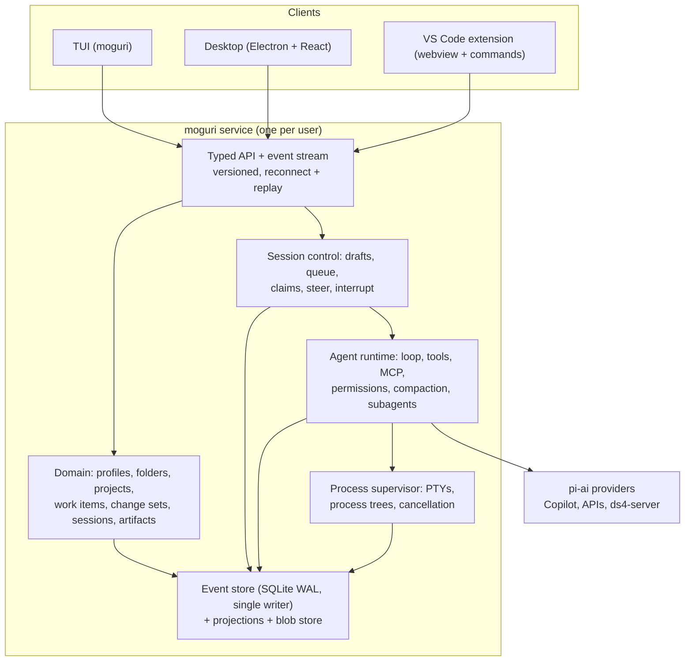

# Moguri from zero: complexity assessment

**Assessment date: 2026-10-17. Status: research and recommendation, not an adopted architecture.**

This document estimates what it takes to build Moguri without forking OpenCode or Pi. It complements the [Pi versus OpenCode critique][C], which compared the two fork candidates.

## Verdict

**A from-zero Moguri is feasible, but only if "from zero" means owning the architecture, the domain model, the local service and all clients while still using proven libraries for commodity parts.** Writing your own model providers, terminal emulator, PTY layer, diff renderer or MCP client would add months and produce no Moguri-specific value.

- **Size:** the first release, meaning the local service, TUI and desktop app passing the brief's acceptance checks, is roughly **74–114 engineer-weeks** of senior work before AI assistance. With heavy coding-agent use, plan for **about 45–85 calendar weeks for one person**. The optional VS Code-compatible extension adds **4–8 weeks**. The full later-work list adds roughly **113–212 more engineer-weeks**.
- **The difficulty is not the chat loop.** The difficulty is a crash-safe event model, atomic queue claims across concurrent clients, cancellation that reaches every owned process, and a desktop interface that stays fast and truthful while all of this happens.
- **Starting from zero is the right choice only if the durable event model is the product.** If it is, retrofitting it into a fast-moving fork may cost more than building it first. If you mainly want OpenCode plus features, fork instead.
- **Recommended shape:** TypeScript end to end. One local service owns all state. A TUI, an Electron/React desktop app and an optional VS Code extension are thin clients over one typed protocol. Use `pi-ai` (and optionally `pi-agent-core`) for providers, GitHub Copilot login and local OpenAI-compatible servers such as ds4.
- **The biggest from-zero risk is agent quality, not features.** Mature harnesses have spent years tuning edit tools, compaction and provider quirks. Build an evaluation suite in the first month, or you will not know whether your harness is worse.

These are planning estimates based on judgement, not measurements. Section 7 states the assumptions.

## 1. What "from zero" means here

| Option | You write | You reuse | Use when |
| --- | --- | --- | --- |
| **Z0. Pure scratch** | Everything except the language runtime, UI frameworks and basic packages, including provider adapters, Copilot OAuth, the agent loop and tools. | Very little. | Not recommended. Provider churn alone is a full-time job. |
| **Z1. Own architecture, borrowed engine** (recommended from-zero shape) | Domain model, event store, protocol, service, session control, cancellation, worktrees, artifacts, metrics, profiles, all clients and Moguri UX. | `pi-ai` providers and auth, optionally `pi-agent-core`; MCP SDK; PTY; terminal emulator; diff renderer; SQLite driver; UI toolkits. | The durable domain model must be first-class and you accept building both clients. |
| **F. Fork OpenCode** | Moguri's domain model, retrofitted into upstream storage and clients, plus upstream merge maintenance. | Most of the runtime, TUI, desktop, terminal, diffs and providers. | You want a usable product soon and accept upstream-shaped internals. See the [critique][C]. |

Z1 overlaps with the critique's "Pi libraries" option: it consumes Pi's packages as libraries, not as a fork of Pi's CLI. The difference is that Z1 also writes the TUI instead of reusing `pi-tui`, so that both clients come from one design.

The rest of this document assumes Z1 unless stated otherwise.

## 2. Requirements in scope

- **CLI and TUI.** First-class client.
- **Desktop app with sleek UI/UX.** First-class client, including the desktop-only sidebar from the [sidebar specification][S].
- **Optional IDE extension compatible with VS Code.** Treated here as the brief's `vslocal` VSX client (`L26`). `vslocal` is a private VS Code-based editor, so the extension must also run in standard VS Code and publish to Open VSX. [V2]
- **All features in the [README][I], the [newest brief][B] and the [expanded draft][E].** Section 9 maps all 112 requirement IDs from the critique, plus two user-stated requirements: GitHub Copilot login (`U01`) and local DeepSeek through `antirez/ds4` (`U02`).

## 3. Target architecture

Architecture rules that make the rest tractable:

1. **One process owns state.** The desktop app starts or attaches to the service. It never hosts the agent loop in Electron's main process. This is the main lesson from `pi-gui` in the [critique][C].
2. **Every durable change is one typed event, written by one writer.** Projections such as session lists, dashboards and queue views are rebuilt from events. Use one write connection to SQLite. OpenCode's unbounded write-ahead-log growth from several connections is a cautionary example. [C]
3. **The protocol is schema-first.** Define commands, events and errors once, then generate TypeScript clients and JSON Schema. Version the protocol from day one. The VS Code extension updates on a different schedule from the desktop app, so version skew is normal, not exceptional.
4. **Clients send commands and render projections.** Optimistic UI is allowed. Authoritative state in a client is not.
5. **Cancellation is a tree.** Each workflow, session, turn, tool call, MCP call, PTY and child process has an owner and a cancellation status of requested, acknowledged, completed, failed or partial.

## 4. Recommended stack

| Layer | Recommendation | Why | Main alternative |
| --- | --- | --- | --- |
| Language | **TypeScript everywhere** | The VS Code extension must be JavaScript or TypeScript. The desktop renderer is web. Protocol types can be shared across all four codebases. The strongest agent libraries are TypeScript. | Rust or Go service with generated TypeScript types. This gives better process control and footprint, but duplicates types and loses the agent library ecosystem. |
| Service runtime | **Node.js or Bun**, decided by a spike | Electron and `node-pty` are Node-native. Bun offers single-file builds. | Verify native modules, PTY behavior and SQLite under the chosen runtime before committing. |
| Providers and auth | **`pi-ai`** (MIT) | Already supports GitHub Copilot through OAuth, many API providers, and any OpenAI-compatible server, including llama.cpp-style endpoints. [P1] | Vercel AI SDK (Apache-2.0) [L5]. Broad providers, but Copilot login would be yours to write and maintain. |
| Agent loop | **`pi-agent-core`** (MIT) or a thin own loop | `pi-agent-core` depends only on `pi-ai` and TypeBox. [P2] Owning the loop is acceptable because it is small, while the tools and context policy are where quality lives. | Own loop from the start. |
| MCP | **Official MCP TypeScript SDK** | Spec-tracking client. The license is in transition from MIT to Apache-2.0. [L3] | None worth considering. |
| Storage | **SQLite** in WAL mode, single writer, plus a content-addressed blob directory | Matches the brief. Embedded, inspectable and easy to back up. | Postgres is unnecessary for a local-first single-user service. |
| TUI | **OpenTUI with React** | Same React mental model as the desktop app, so client state hooks can be shared. OpenTUI also offers Solid. It runs on Bun 1.3.14+ or Node.js 26.4+. [L1] | Ink (React, mature, simpler rendering model) [L2]. Bubble Tea or Ratatui only if the service is written in Go or Rust. [L8], [L9] |
| Desktop | **Electron + React + Vite** | The service is TypeScript anyway. Chromium renders the same on every OS. Webview components can be reused in VS Code. Stay on a supported Electron major. [X1], [X2] | Tauri + React. Smaller binaries, but different system WebView engines per OS and a Node sidecar to package. [X3], [X4] |
| Terminal | **`node-pty` + xterm.js** | Standard pairing used by VS Code-class tools. [L4], [L6] | Ghostty-web, used by OpenCode, after a rendering spike. |
| Diffs | **`@pierre/diffs`** (Apache-2.0) or CodeMirror merge view | Purpose-built, Shiki-based diff rendering. [L7] | Monaco diff editor, which is heavier. |
| IDE extension | **VS Code extension API + webview** | Native commands, diff views and status bar, with React views reused from the desktop app. [V1] | A web-only client, which would lose native editor integration. |

The Electron versus Tauri and React versus Solid choices are yours. The recommendation favors Electron + React because it matches your Vite/React preference, keeps one JavaScript runtime and lets the VS Code webview reuse desktop components.

## 5. Where the complexity actually lives

Ranked by risk of delaying or breaking the first release:

1. **Cancellation and process ownership.**
   - Killing a process tree reliably differs on macOS, Linux and Windows.
   - PTYs, detached grandchildren, MCP servers launched over stdio, and provider streams that ignore aborts all leak.
   - The brief requires reporting exactly what survived, not just trying to stop it.
   - Start with macOS and Linux. Treat Windows as a separate milestone because it uses job objects and ConPTY.
2. **Durable event model under concurrency.**
   - Atomic queue claims, edits racing claims, idempotent transitions and restart reconciliation are distributed-systems problems inside one machine.
   - Two clients plus the agent loop are already three writers competing for the same session.
   - Property-based and fault-injection tests are required, not optional.
3. **Agent quality.**
   - The edit tool's success rate, context compaction, prompt caching, retries and malformed tool-call repair decide whether people trust the harness.
   - OpenCode and Pi encode years of tuning here. A from-zero harness starts behind.
   - Mitigation: borrow `pi-agent-core` and Pi's MIT-licensed tool implementations where they fit, and build a golden-task evaluation suite before adding features.
4. **Desktop UX and performance.**
   - A streaming, virtualized timeline with Markdown, collapsible reasoning, tool cards, diffs and terminals must stay smooth across long sessions.
   - Accessibility, focus handling and keyboard flows must be designed in, not added later.
   - "Sleek" mostly means fast, quiet and honest about state. That is engineering more than visual design.
5. **Truthful accounting.**
   - Keep estimated, provider-reported and billed costs separate.
   - Snapshot prices with their source and effective date.
   - Define turn and steer time windows so they never overlap.
   - Every dashboard number must trace to stored events.
6. **Packaging and distribution.**
   - Signed and notarized macOS builds, Linux packages and auto-update.
   - Bundle the service binary inside the desktop app while still letting the TUI use the same service.
   - Publish the extension to Open VSX and the Visual Studio Marketplace.
7. **Three clients multiply surface work.**
   - Every feature needs a TUI design, a desktop design and possibly an extension design.
   - Keep the TUI deliberately smaller than the desktop app, and the extension smaller still.
   - Share the client SDK, state hooks and formatting, never the authority.

## 6. Subsystem estimate for the first release

Sizes are in engineer-weeks for one senior full-stack engineer working full time, before AI assistance. Ranges include design, implementation, tests and documentation for the first-release scope only.

| # | Subsystem | Requirement IDs | Size | Engineer-weeks | Notes |
| --- | --- | --- | --- | --- | --- |
| 1 | Monorepo, build, CI, packaging, signing, updates | F01, F26 (part) | L | 3–5 | Includes the service binary, desktop bundling, macOS notarization and Linux packages. |
| 2 | Domain model, event store, projections, migrations, export and backup | F02–F08 | XL | 8–12 | The foundation. Migrations and restart reconciliation are required from the first schema. |
| 3 | Protocol, client SDK, reconnect and replay, stale-write rejection | F04, S13 | L | 4–6 | Schema-first, versioned, with local-only authentication on loopback or a Unix socket. |
| 4 | Agent runtime: tools, MCP, permissions, compaction, subagents, questions, providers | F11 (data), F23, P06, P07, U01, U02 | XL | 6–9 | With `pi-ai`. Without it (Z0), expect 14–20. |
| 5 | Session control: lifecycle, drafts, queue, claims, Queue/Steer/Interrupt | F10, F12–F15 | L | 6–8 | Concurrency and property tests included. |
| 6 | Process supervisor and cancellation tree | F16, F17, S04 (service side), S15 | L | 5–8 | macOS and Linux. Windows adds 3–6 weeks later. |
| 7 | Projects, worktrees, change sets, Git gates, connector-gated starts | F18–F21 | L | 5–7 | Worktree leases, dirty detection and explicit push, merge and rebase actions. |
| 8 | Artifacts, questions, archive and retention | F22–F25, F08 (UI) | M | 3–4 | Artifact lifecycle independent of sessions, plus the project-deletion flow. |
| 9 | Usage events, cost ledger, budgets, dashboard queries | M01–M15, S09, S10 | L | 6–8 | Correct time windows and pricing snapshots are the hard part. |
| 10 | Profiles, secrets, plugin manifests, local-model health, network disclosure | P01–P05, P08, P09 | L | 6–9 | OS keychains on each platform, hardware detection and profile isolation tests. |
| 11 | TUI client | F09–F14, F17, M13 (TUI views) | L | 6–10 | Navigation, splits, palette, timeline, queue editing, stop controls and a basic dashboard. |
| 12 | Desktop client and sidebar | F09–F17, M11–M13, S01–S05, S08, S11, S12, S14 | XL | 12–20 | Timeline, diffs, terminal, files, insights, extensions shell, palette, splits, accessibility and performance work. |
| 13 | Break-it hardening | F26, Phase 6 | L | 4–8 | Crashes, races, full disks, corrupt state, provider outages and incompatible plugins. |
| | **Total (Z1)** | | | **74–114** | About 17–26 engineer-months. |
| | **Total (Z0, own providers and loop)** | | | **82–125** | Row 4 becomes 14–20. |

With heavy coding-agent assistance, implementation gets faster. Design, cross-platform debugging, UX iteration and hardening speed up much less. A factor of 0.6–0.75 gives **roughly 45–85 calendar weeks for one person** for Z1.

For comparison, a first release on an OpenCode fork is roughly **45–75 engineer-weeks**, with low confidence. It saves most of rows 4, 6, 11 and 12, but adds retrofit work to put the event model into upstream storage and clients, plus ongoing upstream merges. Phase 0 of the fork plan would measure this properly. The fork reaches daily use within days. With agent assistance, Z1 needs about 5–9 calendar weeks to reach a TUI you can use daily, and about 8–14 calendar weeks before the desktop app attaches to the same session (phases 1 and 2 in section 10).

## 7. Assumptions and critique of the from-zero plan

### Assumptions behind the numbers

- One experienced engineer who knows TypeScript, React, SQLite and process management.
- macOS first, Linux second, Windows deferred.
- First-release scope only, as defined by the newest brief. Later work is estimated separately in section 8.
- Libraries are adopted, not rewritten (Z1).
- No time lost to rewrites caused by changing requirements. In practice, budget 20–30% for that.

### Critique

- **"From scratch" can become building a harness instead of a product.** The first 3–4 months produce infrastructure nobody else can see. Set a hard milestone to use Moguri for your own daily work by week 8–10, even through the TUI alone.
- **Three clients triple the UI decisions.** The VS Code extension is optional. Keep it optional until the protocol has been stable for at least one release.
- **Provider churn never ends.** Delegating providers to `pi-ai` makes Pi's release cadence a dependency. Pin its version, wrap it behind a Moguri provider interface, and keep raw provider data for debugging, as the brief requires.
- **GitHub Copilot access through a third-party client is a policy question as well as a technical one.** Using a library's OAuth flow does not move responsibility for GitHub's terms to that library. Check the current terms before shipping Copilot login as a headline feature.
- **Local models change the performance envelope.** ds4 through `ds4-server` is just another OpenAI-compatible endpoint (`U02`), but local generation is slow. Budget and timing UI must handle long turns without looking stuck.
- **Your repository instructions assume a fork.** `AGENTS.md` and the newest brief say Moguri "began as a fork of OpenCode" and that Phase 0 maps the fork. Adopting Z1 means rewriting Phase 0 as "choose libraries and run spikes", and removing fork language from the brief and README.
- **The later-work list is larger than the first release.** It is the main source of schedule risk. Section 8 shows why.

## 8. Later work and the VS Code extension

| Group | Requirement IDs | Engineer-weeks | What makes it hard |
| --- | --- | --- | --- |
| VS Code-compatible extension | L26 | 4–8 | Thin client: commands, webview reusing desktop React views, native diff, terminal bridged with a pseudoterminal, protocol version negotiation, compatibility with both VS Code and `vslocal`. Cheap only if the protocol is already stable. |
| Shortcuts, inspectable views, repeated-prompt commands | L01, L03, L04 | 3–6 | Mostly UI after the first release. Prompt detection needs privacy-respecting local clustering. |
| Dictation | L02 | 4–8 | Local speech model packaging, microphone permissions and a global hotkey. |
| Session groups, handles, multi-repo streams, stacked PRs, remote execution | L05–L09 | 16–30 | Orchestrator ownership, cross-repository ordering and identical policies, budgets and stop controls on remote backends. |
| Gallery, manifests, self-evolution, policy packs, Git hygiene, Python tools | L10–L18 | 16–28 | Evolution needs proposal, evaluation, approval, versioning and rollback. Policy packs need enforcement, not just prompts. |
| GitHub and tracker plugins | L19–L21 | 6–10 | Review-thread read, write and resolve; CI log access; merge and rebase policies. |
| First-party integrations | L22–L25 | 8–14 | `sendbox` containment, `porto` ownership, `sql-not-so-lite` read-only versus destructive actions, `stainless` browser panel. |
| Hugging Face model install | L27 | 3–5 | Disclose size, license and trust before downloading. Resume interrupted downloads. |
| Metachat | L28 | 3–5 | Settings changes go through the same commands and policies as the UI. |
| Scheduler, CI watch, roundups, My work, workflows | L29–L32 | 8–14 | Durable timers, missed-run policy, cursors and bounded scope. |
| Personas and agent modes | L33–L43 | 20–40 | Mostly prompts and policies on one runtime. Evaluations are the real cost. |
| Memory | L44 | 6–12 | Source, confidence, scope, expiry and profile ownership. Core memory is user-only. |
| Research spikes | L45–L47 | 12–24 | Virtualized worktrees, CRDT worktrees and model provenance. Measure before building. |
| Desktop sidebar later panels | S06, S07 | 4–8 | Stainless browser and side chat. |
| **Total** | | **113–212** | About 2.5–4.5 additional engineer-years before AI assistance. |

Counting an engineer-year as about 46 working weeks, the complete vision is roughly **4–7 engineer-years before AI assistance** (187–326 engineer-weeks). That is the strongest argument for keeping later work behind the first-release acceptance checks.

## 9. Complete feature map

Sizes are marginal costs **after** the subsystems they depend on exist. Do not add up the rows; section 6 is the budget. Sizes: **S** under 1 week, **M** 1–3 weeks, **L** 3–6 weeks, **XL** over 6 weeks. IDs match the [critique's feature map][C].

### Foundation and session control

| ID | Requirement | Size | Main complexity driver |
| --- | --- | --- | --- |
| F01 | Local-first core; no required Moguri cloud; exportability | M | Every feature must work offline except provider calls and connectors. |
| F02 | Profile > Folder > Project > Work item, change sets, sessions, independent artifacts | L | Ownership rules and deletion semantics across the tree. |
| F03 | Session > Turn > Step; typed IDs, versions, parent and correlation IDs | M | Envelope design that survives schema evolution. |
| F04 | One typed API and event stream; no client-owned authority | L | Schema-first protocol, code generation and version negotiation. |
| F05 | Append-only events, projections, atomic transitions, crash-safe writes | XL | Single-writer store, projection rebuilds and transactional claims. |
| F06 | Migrations, restart reconciliation, diagnostics; never delete state to upgrade | L | Migration tests on generated fixtures for every schema version. |
| F07 | Content-addressed blobs; export, backup, restore | M | Consistent snapshots while the service runs. |
| F08 | Trash, tombstones, purge; retention by days or GB, default off | M | Pinned artifacts excluded; storage accounting. |
| F09 | TUI and desktop clients; navigation, split panels, command palette | XL | Two complete UIs sharing one client SDK. |
| F10 | Session state views and event log | M | Projection queries and a filterable event log. |
| F11 | Compact and detailed views for messages, tools, MCP, steers, subagents, reasoning | L | Streaming render performance; only provider-returned reasoning. |
| F12 | Persistent drafts and queued messages across app closure | M | Debounced draft events; attachments as blobs. |
| F13 | Reorder, edit, delete unclaimed messages; atomic claims | M | Compare-and-set on queue position and claim state. |
| F14 | Queue, Steer and Interrupt as separate behaviors | L | Safe steer points and confirmed stop before interrupt delivery. |
| F15 | Idempotent transitions; accepted messages survive | M | Request IDs and deduplication. |
| F16 | Cancellation from workflow to process tree | XL | Cross-platform process ownership and partial outcomes. |
| F17 | Every owned process visible and stoppable in both clients | L | Process registry projection and stop status UI. |
| F18 | Worktree create, discover, open, remove; dirty and external-change detection | L | Git edge cases and filesystem watching. |
| F19 | Worktree leases; branch, commits, diff and PR tracking | M | Lease conflicts between active sessions. |
| F20 | Push, merge, rebase, branch deletion only by user action or policy | M | Policy engine hook on every Git command path. |
| F21 | Start from GitHub, Linear or Jira items through authorized connectors | M | Connector capability detection. |
| F22 | Artifacts with revisions, status, scope and provenance | M | Revision model and source-event links. |
| F23 | Persist structured questions and answers; policy-controlled promotion | M | Question tool contract shared by all clients. |
| F24 | Artifacts survive session deletion; project-deletion choices | M | Preview, export, write to `artifacts/`, commit or delete. |
| F25 | Searchable, restorable, individually deletable archive | M | Full-text index over projections. |
| F26 | Unit, integration, migration, restart, cross-client and fault tests | XL | Fault injection harness; ongoing cost. |

### Metrics, cost and budgets

| ID | Requirement | Size | Main complexity driver |
| --- | --- | --- | --- |
| M01 | Model, provider and token usage | S | Normalized by `pi-ai`; store raw values too. |
| M02 | Token categories: system prompt, messages, tool schemas, tool calls, MCP, compaction | M | Splits below one request are estimates and must be labelled. |
| M03 | Tool and MCP calls, failures, retries, cancellations and rates | S | Derived from runtime events. |
| M04 | Script, command, subsession, subagent, group and session time | M | Nested timers with clear ownership. |
| M05 | Wall time versus active model, tool, MCP and terminal time | M | Clock definitions and overlap rules. |
| M06 | Per-turn and per-steer tokens and time | M | Attribution when steers split a turn. |
| M07 | Generation throughput, weighted turn and session totals | S | Measured or explicitly estimated. |
| M08 | Estimated price with unit price, source, currency and effective date | M | Price snapshots per request. |
| M09 | Separate estimated, provider-reported and billed amounts | M | Ledger with three fields and reconciliation. |
| M10 | Profile and session budgets; warning and hard stop | M | Atomic check before each model request. |
| M11 | Dashboard ranges and day, week and month grouping | M | Time-zone-correct aggregation. |
| M12 | Filters by folder, project, repository, organization, visibility, profile, provider, model, session | M | Indexed projections. |
| M13 | Session page with price, tokens, compactions, metadata, timers, storage, delete | M | Desktop and TUI views over one query. |
| M14 | Every total traceable to events; local analytics; opt-in telemetry | M | Drill-down from totals to events. |
| M15 | Experimental velocity metrics | M | Metric definitions; avoid vanity measures. |

### Profiles, providers and extensibility

| ID | Requirement | Size | Main complexity driver |
| --- | --- | --- | --- |
| P01 | Work and Open Source profiles with bound projects, accounts, keys, routing, budgets, policies | L | Profile scoping in every query and command. |
| P02 | Isolated artifacts and memory; explicit credential sharing | L | Isolation tests across all stores. |
| P03 | Secrets in the OS keychain or an explicit backend; never in prompts, events or logs | M | Per-OS keychain support and log redaction. |
| P04 | Language, accent, voice and presentation per profile | S | Preferences separate from domain state. |
| P05 | Plugin manifests: capabilities, settings, permissions, hooks, versions; no silent permission growth | L | Permission diffing on update. |
| P06 | Normalized provider capabilities plus raw diagnostic data | M | Wrapper over `pi-ai`. XL if written from zero. |
| P07 | Optional `llm` adapter | M | Subprocess or HTTP bridge with streaming. |
| P08 | Local runtime detection and hardware health checks | L | OS, driver, accelerator, RAM, VRAM and disk detection per platform. |
| P09 | Disclose every remote destination with its purpose | L | Central network layer that every request passes through. |
| U01 | GitHub Copilot login (user-stated) | S | Provided by `pi-ai`. L plus maintenance if written from zero. Check GitHub's terms. |
| U02 | Local DeepSeek through `antirez/ds4` (user-stated) | S | OpenAI-compatible endpoint. UI must tolerate slow local generation. |

### Desktop sidebar

| ID | Requirement | Size | Main complexity driver |
| --- | --- | --- | --- |
| S01 | Persistent sidebar with seven entries; collapse, resize, badges, splits | M | Layout persistence per window. |
| S02 | Panels follow the main session; keyboard, focus, labels, accessibility | M | Focus management and screen-reader labels. |
| S03 | Changes panel with diffs, links and explicit Git actions | L | Diff rendering, conflicts and external changes. |
| S04 | Terminal panel; closing the view does not kill the process | L | PTY streaming and reattach after reconnect. |
| S05 | Files panel with search, previews and conflict-checked edits | M | Service-side edits with external-change detection. |
| S06 | Stainless browser panel (later) | L | Integration health, permissions, Playwright. |
| S07 | Side chat with source-referenced context (later) | M | Separate session linked to the main one. |
| S08 | Insights panel with live metrics and diagnostics | M | Live projection subscriptions. |
| S09 | Steer windows: requested and applied times, no overlap | M | Precise event timestamps. |
| S10 | Generation tokens per second; unavailable and estimated states | S | Display of M07. |
| S11 | Optional inline turn footer; provisional then settled values | S | Global preference with session override. |
| S12 | Extensions panel for canvas extensions and MCP Apps | L | Sandboxed views, grants, health. |
| S13 | Shared queries; reconnect replay before mutation; stale writes rejected | L | Event sequence numbers and version checks. |
| S14 | Loading, empty, unavailable, disconnected, denied, failed, cancelled, partial states | M | Product-wide state component library. |
| S15 | Main and side-chat cancellation kept separate unless workflow ownership says otherwise | M | Cancellation tree ownership. |

### Later work and research

| ID | Requirement | Size | Main complexity driver |
| --- | --- | --- | --- |
| L01 | Configurable shortcuts | S | Shared command registry. |
| L02 | Option/Ctrl+Space dictation | L | Local speech model and OS permissions. |
| L03 | Repeated-prompt detection and suggested commands | M | Local similarity clustering. |
| L04 | Inspectable prompts, reasoning, tools, steering and subagents with timers | S | Built on F11 and M04. |
| L05 | Session groups with optional, attachable orchestrator | L | Ownership transfer and safe detach. |
| L06 | Stable `@` handles; group tasks, time, tokens, stop | M | Handle registry scoped by profile and project. |
| L07 | Multi-repository work streams; ordered PRs; policy-gated merges | XL | Cross-repository dependency ordering. |
| L08 | GitHub stacked PRs | L | Restacking and stale bases. |
| L09 | Optional remote or hosted execution | XL | Same permissions, budgets, events and stop controls remotely. |
| L10 | Gallery for plugins, skills, hooks, workflows, personas, policy packs | L | Distribution, trust and updates. |
| L11 | Structured manifests; directly invocable skills; slash commands | M | Manifest schema and command registry. |
| L12 | Self-evolving skills, hooks and tools with evaluation, approval and rollback | XL | Evaluation harness and versioning. |
| L13 | Policy packs for GitHub, vulnerabilities, conflicts, logging, commits, docs, stack, coding | L | Enforcement points, not just prompts. |
| L14 | Linted commit messages, SSH signing, no tool co-author trailers | M | Git hooks and signing key access. |
| L15 | `--silent`, truncated output, terse "caveman" mode | S | Output policy in tools and prompts. |
| L16 | Durable docs under `docs/` | S | Policy pack rule. |
| L17 | Import policies from `copilot-instructions.md` sources | M | Parsing and conflict resolution with Core. |
| L18 | Built-in Python helper tools | M | Packaging a Python runtime or requiring one. |
| L19 | GitHub plugin: issues, PRs, CI checks, Actions logs, review threads | L | API coverage and rate limits. |
| L20 | Bot PR handling; ecosystem-specific vulnerability fixes | L | Verification before merge. |
| L21 | Merge versus rebase policies | M | Policy evaluation per target branch. |
| L22 | `sendbox` sandbox per profile | L | Filesystem, network and process containment. |
| L23 | `porto` dev servers and container stacks | M | Ownership of attached versus started stacks. |
| L24 | `sql-not-so-lite` databases | M | Read-only versus destructive operations. |
| L25 | `stainless` browser and Playwright | L | MCP plus desktop integration. |
| L26 | VS Code-compatible extension (`vslocal` VSX) | L | See section 8. M if desktop React views are reusable. |
| L27 | Guided Hugging Face model install | L | Disclosure, resumable downloads, trust. |
| L28 | Metachat | M | Settings changes through normal commands and policies. |
| L29 | Scheduled CI watches | M | Event-driven polling with backoff. |
| L30 | Dependency roundups | M | Cursors and bounded scope. |
| L31 | My work view | M | Connector queries and UI. |
| L32 | Scheduled prompts and readable prompt-plus-script workflows; optional server | XL | Durable scheduler, workflow syntax, missed runs. |
| L33 | User-defined continuous personas | L | Persona manifests with budgets and memory. |
| L34 | Product Manager persona | XL | Analytics integration and measurable outcomes. |
| L35 | Maintenance persona | L | Breaking-change fixes and safe merges. |
| L36 | Docs persona | M | Triggers on meaningful changes. |
| L37 | Deep Search mode | L | Source tracking and stopping rules. |
| L38 | SRE mode with read-only infrastructure access | L | Enforced read-only permissions. |
| L39 | Autopilot | L | Completion criteria and checkpoints. |
| L40 | Long-running Autopilot | XL | Multi-day checkpoints, recovery and budgets. |
| L41 | Stabilize mode | L | Many integrations under one policy. |
| L42 | Swarm mode | XL | Roadmap approval and coordinated execution. |
| L43 | Team and council personas | L | Multi-agent coordination on one runtime. |
| L44 | Core, Sky, Terra and Glacier memory | XL | Provenance, expiry, promotion rules and isolation. |
| L45 | Virtualized worktrees (research) | XL | Must beat Git worktrees and filesystem snapshots. |
| L46 | CRDT worktrees (research) | XL | Textual merging does not resolve semantic conflicts. |
| L47 | Model blame and provenance (research) | L | Rebases, formatters and human edits. |

## 10. From-zero build order

This replaces the fork-mapping Phase 0 only if you adopt Z1. Later phases keep the brief's order.

| Phase | Goal | Exit check | Cumulative engineer-weeks |
| --- | --- | --- | --- |
| 0. Decisions and spikes | Record architecture decisions: runtime, Electron or Tauri, OpenTUI or Ink, protocol schema tool. Spike `pi-ai` with Copilot and ds4, PTY tree killing, the SQLite single-writer store and a desktop shell attaching to the service. | Each spike has a pass or fail result and a written decision under `docs/`. | 2–3 |
| 1. Walking skeleton | Service, event store, protocol, one session with read, edit, shell and search tools, and a TUI. Start the golden-task evaluation suite. | You use Moguri's TUI for real work. Restart loses nothing. | 8–12 |
| 2. Second client | Desktop shell attaching to the same session. | A session created in the TUI is controlled from desktop, and the reverse. | 12–18 |
| 3. Session control | Drafts, queue, claims, Queue/Steer/Interrupt, cancellation tree, stop controls. | Queue, cancellation and concurrent-client acceptance checks pass. | 26–38 |
| 4. Work items and artifacts | Projects, worktrees, change sets, artifacts, archive. | Artifact and worktree acceptance checks pass. | 36–51 |
| 5. Analytics and budgets | Usage, cost ledger, budgets, dashboard, insights. | Every dashboard total traces to events. | 44–61 |
| 6. Profiles and extensions | Profiles, secrets, plugin manifests, local-model health. | Profile isolation checks pass. | 54–76 |
| 7. Desktop polish and break-it | Sidebar panels, accessibility, performance budgets, fault injection, signed builds. | All first-release acceptance checks pass. | 74–114 |
| 8. VS Code extension | Thin client over the stable protocol. | Same session controllable from TUI, desktop and the editor. | +4–8 |

## 11. Decision

| Your priority | Choose |
| --- | --- |
| A usable Moguri this quarter | Fork OpenCode, per the [critique][C]. |
| Durable events, truthful cancellation and one protocol as the core of the product | **Z1: own architecture with borrowed engine libraries.** |
| Total control, including providers and the agent loop | Z0 is possible, but it costs about 8–11 extra weeks up front and ongoing provider maintenance, with no user-visible benefit. |
| React desktop and a reusable VS Code webview | Z1 with Electron + React, or a fork that accepts OpenCode's Solid UI. |

**Bottom line:** starting from zero is not reckless if you borrow the engine and own the product. With agent assistance it costs roughly 5–9 weeks before daily TUI use and one to one-and-a-half years of focused solo work before a first release meeting every acceptance check. Choose it only if the event model, cancellation guarantees and multi-client protocol are the reason Moguri exists. Otherwise the fork reaches users sooner.

## Sources

Repository documents:

- [B]: newest build brief.
- [E]: expanded implementation draft.
- [I]: README feature inventory.
- [S]: desktop sidebar specification.
- [C]: Pi versus OpenCode critique, including OpenCode, Pi and `pi-gui` evidence.

External sources (library facts checked 2026-10-17; pinned where a revision was inspected):

- [P1]: `pi-ai` README at the Pi revision inspected in the critique: GitHub Copilot OAuth, OpenAI-compatible APIs and llama.cpp support.
- [P2]: `pi-agent-core` manifest: MIT, depends on `pi-ai` and TypeBox.
- [L1]: OpenTUI core README: React and Solid renderers; Bun 1.3.14+ or Node.js 26.4+.
- [L2]: Ink v8.0.0 release.
- [L3]: MCP TypeScript SDK license, MIT to Apache-2.0 transition.
- [L4]: `node-pty` repository.
- [L5]: Vercel AI SDK license, Apache-2.0.
- [L6]: xterm.js 6.0.0 release.
- [L7]: Pierre `diffs-v1.5.2` release.
- [L8]: Bubble Tea v2.1.0 release.
- [L9]: Ratatui v0.30.2 release.
- [V1]: VS Code webview API guide.
- [V2]: Open VSX registry.
- [X1]–[X4]: Electron support timeline, latest Electron release, Tauri WebView versions and Tauri sidecars, as cited in the critique.

[B]: ../../0-implementation-draft-unslopped.md
[E]: ../../0-implementation-draft.md
[I]: ../../README.md
[S]: ../specs/desktop-sidebar.md
[C]: pi-vs-opencode-critique.md
[P1]: https://github.com/earendil-works/pi/blob/c268154ca1171c2f9eefe75d3d7372a68aada2d5/packages/ai/README.md
[P2]: https://github.com/earendil-works/pi/blob/c268154ca1171c2f9eefe75d3d7372a68aada2d5/packages/agent/package.json
[L1]: https://github.com/anomalyco/opentui/blob/f8f608e2b9a41685d613a1156708ff06c826c3ce/packages/core/README.md
[L2]: https://github.com/vadimdemedes/ink/releases/tag/v8.0.0
[L3]: https://github.com/modelcontextprotocol/typescript-sdk/blob/9bc40e903fde15534ec06ff4c1347d47000dbe16/LICENSE
[L4]: https://github.com/microsoft/node-pty
[L5]: https://github.com/vercel/ai/blob/main/LICENSE
[L6]: https://github.com/xtermjs/xterm.js/releases/tag/6.0.0
[L7]: https://github.com/pierrecomputer/pierre/releases/tag/diffs-v1.5.2
[L8]: https://github.com/charmbracelet/bubbletea/releases/tag/v2.1.0
[L9]: https://github.com/ratatui/ratatui/releases/tag/ratatui-v0.30.2
[V1]: https://code.visualstudio.com/api/extension-guides/webview
[V2]: https://open-vsx.org/
[X1]: https://www.electronjs.org/docs/latest/tutorial/electron-timelines
[X2]: https://github.com/electron/electron/releases/tag/v44.9.0
[X3]: https://v2.tauri.app/reference/webview-versions/
[X4]: https://v2.tauri.app/develop/sidecar/
